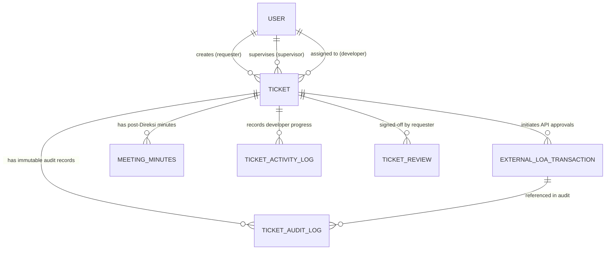

# Data Model Specification: Sistem IT Helpdesk Enterprise

**Feature Branch**: `004-sso-loa-integration`  
**Date**: 2026-10-28  
**Status**: Completed (Phase 1)  
**Governance**: Aligned with Constitution v3.1.0

---

## 1. Entity-Relationship Overview

---

## 2. Table Specifications & Eloquent Entities

### A. Table: `users` (Updated)

| Column | Type | Attributes | Description |
|:---|:---|:---|:---|
| `id` | BIGINT UNSIGNED | PK, Auto Increment | Primary key pengguna |
| `sso_id` | VARCHAR(191) | Nullable, Unique, Indexed | Identitas ID pengguna dari server SSO korporat |
| `name` | VARCHAR(255) | Not Null | Nama lengkap pengguna dari SSO |
| `email` | VARCHAR(255) | Unique, Indexed | Alamat email resmi perusahaan |
| `password` | VARCHAR(255) | Nullable | Hashed password (dummy placeholder untuk pengguna SSO) |
| `role` | VARCHAR(50) | Not Null, Indexed | Peran: `requester`, `supervisor`, `it_head`, `kadiv_it`, `direksi`, `it_developer`, `admin` |
| `department` | VARCHAR(100) | Nullable | Nama departemen/unit kerja pengguna |
| `supervisor_id` | BIGINT UNSIGNED | Nullable, FK -> users.id | ID Atasan Langsung dari pengguna |
| `sso_metadata` | JSON | Nullable | Metadata profil tambahan dari respon SSO (tanpa token) |
| `remember_token` | VARCHAR(100) | Nullable | Remember token bawaan Laravel |
| `created_at`, `updated_at` | TIMESTAMP | Nullable | Timestamps standar Laravel |

---

### B. Table: `tickets` (Updated & Extended)

| Column | Type | Attributes | Description |
|:---|:---|:---|:---|
| `id` | BIGINT UNSIGNED | PK, Auto Increment | Primary key tiket |
| `ticket_number` | VARCHAR(50) | Unique, Indexed | Nomor unik collision-safe: `TICK-YYYYMMDD-XXXX` |
| `requester_id` / `user_id` | BIGINT UNSIGNED | FK -> users.id, Indexed | Pengguna yang membuat tiket |
| `supervisor_id` | BIGINT UNSIGNED | Nullable, FK -> users.id | Atasan langsung penanggung jawab LOA lini pertama |
| `assigned_to` | BIGINT UNSIGNED | Nullable, FK -> users.id, Indexed | Pengembang IT yang mengklaim tiket |
| `title` | VARCHAR(255) | Not Null | Judul permohonan bantuan IT |
| `description` | TEXT | Not Null | Rincian lengkap kebutuhan/masalah |
| `category` | VARCHAR(50) | Not Null, Indexed | Kategori: `hardware`, `software`, `network`, `access`, dll. |
| `classification` | VARCHAR(20) | Nullable, Indexed | Klasifikasi resmi oleh Kabag IT: `minor`, `major` |
| `status` | VARCHAR(50) | Not Null, Indexed | Status alur State Machine (lihat daftar status) |
| `approved_by_supervisor_at` | TIMESTAMP | Nullable | Waktu konfirmasi persetujuan Atasan Langsung via API |
| `approved_by_it_head_at` | TIMESTAMP | Nullable | Waktu persetujuan dan klasifikasi oleh Kepala Bagian IT |
| `approved_by_kadiv_at` | TIMESTAMP | Nullable | Waktu konfirmasi persetujuan LOA Kadiv IT via API |
| `approved_by_direksi_at` | TIMESTAMP | Nullable | Waktu konfirmasi persetujuan LOA Direksi via API |
| `meeting_scheduled_at` | TIMESTAMP | Nullable | Waktu pencatatan rapat koordinasi Major oleh Kabag IT |
| `minutes_submitted_at` | TIMESTAMP | Nullable | Waktu penginputan notulensi oleh user pemohon |
| `minutes_approved_at` | TIMESTAMP | Nullable | Waktu persetujuan notulensi oleh Kabag IT |
| `work_started_at` | TIMESTAMP | Nullable | Waktu developer melakukan self-assign |
| `work_completed_at` | TIMESTAMP | Nullable | Waktu developer menyelesaikan solusi teknis |
| `closed_at` | TIMESTAMP | Nullable | Waktu pemohon menandatangani penutupan resmi |
| `created_at`, `updated_at` | TIMESTAMP | Nullable | Timestamps standar Laravel |

#### Daftar Status Lengkap Tiket (`status` constants in `Ticket.php`):
- `STATUS_DRAFT = 'draft'`
- `STATUS_WAITING_SUPERVISOR = 'menunggu_approval_atasan'` (Menunggu LOA Atasan via API)
- `STATUS_REVISION_REQUESTER = 'revisi_requester'` (Revisi permohonan ke pemohon)
- `STATUS_WAITING_IT_HEAD = 'menunggu_approval_it_head'` (Menunggu persetujuan & klasifikasi Kabag IT)
- `STATUS_REVISION_BY_IT_HEAD = 'revisi_by_it_head'` (Revisi oleh Kabag IT -> wajib verifikasi Atasan)
- `STATUS_WAITING_LOA_KADIV_IT = 'menunggu_loa_kadiv_it'` (Menunggu LOA Kadiv IT via API)
- `STATUS_WAITING_LOA_DIREKSI = 'menunggu_loa_direksi'` (Menunggu LOA Direksi via API)
- `STATUS_WAITING_MAJOR_MEETING = 'menunggu_rapat_major'` (Tahap C.3: Pasca-Direksi Menunggu Rapat Kabag IT)
- `STATUS_WAITING_USER_MINUTES = 'menunggu_input_notulensi'` (Tahap C.4: Menunggu Input Notulensi oleh User)
- `STATUS_WAITING_MINUTES_APPROVAL = 'menunggu_approval_notulensi'` (Tahap C.5: Menunggu Approval Notulensi Kabag IT)
- `STATUS_REVISION_MINUTES = 'revisi_notulensi_major'` (Revisi Notulensi Major oleh User)
- `STATUS_READY_FOR_WORK = 'siap_dikerjakan'` (Antrean terbuka di Pool Siap Progress)
- `STATUS_IN_PROGRESS = 'dalam_pengerjaan'` (Sedang ditangani oleh developer penanggung jawab)
- `STATUS_WAITING_USER_REVIEW = 'menunggu_review_user'` (Solusi teknis diserahkan ke pemohon)
- `STATUS_REVISION_WORK = 'revisi_pekerjaan'` (Pemohon meminta perbaikan hasil pekerjaan)
- `STATUS_COMPLETED = 'selesai'` (Tiket ditutup resmi oleh pemohon)
- `STATUS_REJECTED_SUPERVISOR = 'ditolak_atasan'` (Terminal: Pool Tiket Ditolak)
- `STATUS_REJECTED_IT_HEAD = 'ditolak_it_head'` (Terminal: Pool Tiket Ditolak)
- `STATUS_REJECTED_KADIV_IT = 'ditolak_kadiv_it'` (Terminal: Pool Tiket Ditolak)
- `STATUS_REJECTED_DIREKSI = 'ditolak_direksi'` (Terminal: Pool Tiket Ditolak)

---

### C. Table: `external_loa_transactions` (New Table)

Tabel pencatatan transaksi integrasi pemanggilan API LOA eksternal per tiket per tingkatan otorisasi:

| Column | Type | Attributes | Description |
|:---|:---|:---|:---|
| `id` | BIGINT UNSIGNED | PK, Auto Increment | Primary key transaksi |
| `ticket_id` | BIGINT UNSIGNED | FK -> tickets.id, Indexed | Tiket yang diasosiasikan |
| `approval_level` | ENUM | Not Null | Tingkatan: `supervisor`, `kadiv_it_ops`, `direksi` |
| `external_reference_id` | VARCHAR(100) | Nullable, Indexed | Nomor referensi transaksi dari sistem LOA eksternal |
| `idempotency_key` | VARCHAR(64) | Unique, Indexed | Kunci idempotensi unik untuk proteksi pengiriman ulang |
| `sync_status` | ENUM | Not Null, Default `pending` | Status: `pending`, `synced`, `sync_failed` |
| `decision` | ENUM | Not Null, Default `waiting` | Keputusan: `waiting`, `approved`, `rejected`, `revision` |
| `dispatched_at` | TIMESTAMP | Nullable | Waktu request dikirim ke server LOA eksternal |
| `decided_at` | TIMESTAMP | Nullable | Waktu keputusan approval resmi diterima |
| `dispatch_payload_hash` | VARCHAR(64) | Nullable | SHA256 hash payload untuk verifikasi integritas data |
| `response_payload` | JSON | Nullable | Respons JSON dari API LOA (tersanitasi tanpa token) |
| `last_error_message` | TEXT | Nullable | Catatan error teknis jika terjadi kegagalan/timeout |
| `retry_count` | INT UNSIGNED | Default 0 | Jumlah percobaan retry pengiriman |
| `created_at`, `updated_at` | TIMESTAMP | Nullable | Timestamps standar Laravel |

---

### D. Table: `meeting_minutes` (Updated & Expanded)

Tabel pencatatan notulensi rapat koordinasi pasca-LOA Direksi khusus untuk request Major:

| Column | Type | Attributes | Description |
|:---|:---|:---|:---|
| `id` | BIGINT UNSIGNED | PK, Auto Increment | Primary key notulensi |
| `ticket_id` | BIGINT UNSIGNED | FK -> tickets.id, Indexed | ID tiket Major terkait |
| `submitted_by_user_id` | BIGINT UNSIGNED | FK -> users.id | ID user pemohon yang menginput notulensi |
| `meeting_date` | DATETIME | Not Null | Tanggal dan waktu pelaksanaan rapat |
| `attendees_summary` | TEXT | Not Null | Ringkasan daftar peserta rapat |
| `notes` | LONGTEXT | Not Null | Poin-poin kesepakatan dan kebutuhan teknis hasil rapat |
| `attachment_path` | VARCHAR(255) | Nullable | Path berkas lampiran resmi notulensi di storage privat |
| `is_approved_by_it_head` | BOOLEAN | Default FALSE | Status persetujuan oleh Kepala Bagian IT |
| `approved_by_it_head_id` | BIGINT UNSIGNED | Nullable, FK -> users.id | ID Kabag IT yang menyetujui |
| `approved_at` | TIMESTAMP | Nullable | Waktu pengesahan notulensi oleh Kabag IT |
| `revision_comments` | TEXT | Nullable | Catatan komentar perbaikan jika Kabag IT meminta revisi |
| `created_at`, `updated_at` | TIMESTAMP | Nullable | Timestamps standar Laravel |

---

### E. Table: `ticket_activity_logs`

Catatan kronologi pengerjaan teknis oleh tim pengembang IT:

| Column | Type | Attributes | Description |
|:---|:---|:---|:---|
| `id` | BIGINT UNSIGNED | PK, Auto Increment | Primary key log aktivitas |
| `ticket_id` | BIGINT UNSIGNED | FK -> tickets.id, Indexed | Tiket terkait |
| `user_id` | BIGINT UNSIGNED | FK -> users.id | Developer penanggung jawab yang mencatat log |
| `activity_note` | TEXT | Not Null | Uraian kemajuan penanganan teknis / milestone |
| `attachment_path` | VARCHAR(255) | Nullable | Path lampiran screenshot / bukti pengerjaan |
| `created_at`, `updated_at` | TIMESTAMP | Nullable | Timestamps standar Laravel |

---

### F. Table: `ticket_reviews`

Evaluasi dan penilaian kepuasan akhir oleh pemohon pembuat tiket:

| Column | Type | Attributes | Description |
|:---|:---|:---|:---|
| `id` | BIGINT UNSIGNED | PK, Auto Increment | Primary key review |
| `ticket_id` | BIGINT UNSIGNED | FK -> tickets.id, Indexed | Tiket terkait |
| `reviewer_id` | BIGINT UNSIGNED | FK -> users.id | User pemohon pembuat tiket |
| `rating` | TINYINT UNSIGNED | Nullable | Skor kepuasan (1 s.d 5 bintang) saat Accept |
| `feedback` | TEXT | Nullable | Ulasan masukan pengguna |
| `action` | ENUM | Not Null | Aksi: `accept` (tutup tiket) atau `revision` (kembali ke dev) |
| `created_at`, `updated_at` | TIMESTAMP | Nullable | Timestamps standar Laravel |

---

### G. Table: `ticket_audit_logs` (Immutable)

Jejak audit permanen (*append-only*) untuk kepatuhan dan observabilitas tata kelola:

| Column | Type | Attributes | Description |
|:---|:---|:---|:---|
| `id` | BIGINT UNSIGNED | PK, Auto Increment | Primary key audit log |
| `ticket_id` | BIGINT UNSIGNED | FK -> tickets.id, Indexed | Tiket terkait |
| `actor_id` | BIGINT UNSIGNED | Nullable, FK -> users.id | Pengguna yang mengeksekusi aksi (null jika sistem/API) |
| `action` | VARCHAR(100) | Not Null, Indexed | Jenis tindakan yang dilakukan |
| `from_status` | VARCHAR(50) | Nullable | Status tiket sebelum aksi |
| `to_status` | VARCHAR(50) | Not Null | Status tiket setelah aksi |
| `comments_or_reason` | TEXT | Nullable | Catatan atau alasan penolakan/revisi |
| `external_transaction_id` | BIGINT UNSIGNED | Nullable, FK -> external_loa_transactions.id | Tautan transaksi LOA API jika terkait integrasi |
| `ip_address` | VARCHAR(45) | Nullable | IP address pemanggil aksi |
| `user_agent` | TEXT | Nullable | User agent peramban / webhook sender |
| `payload_diff` | JSON | Nullable | Perubahan atribut penting yang tersanitasi |
| `created_at` | TIMESTAMP | Not Null | Waktu pencatatan mutlak (*append-only*) |
