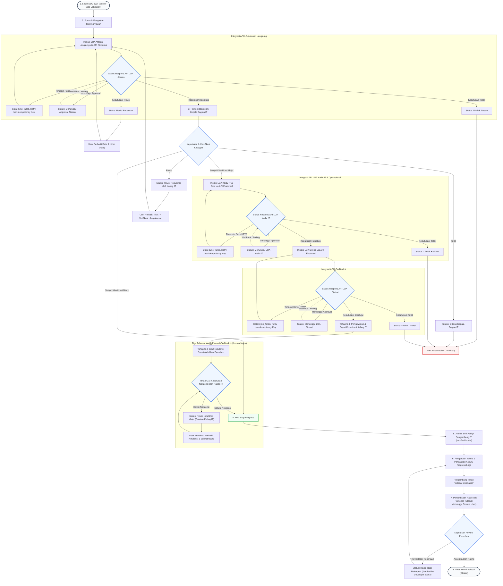

# Master Feature Specification: Sistem Aplikasi IT Helpdesk Internal Perusahaan (End-to-End)

**Feature Branch**: `004-sso-loa-integration`

**Created**: 2026-10-28  
**Last Updated**: 2026-10-28 (Lengkap 10 User Stories komprehensif, percabangan eksplisit, penanganan kegagalan API LOA, alur revisi notulensi pasca-Direksi, dan konsistensi Pool Siap Progress)

**Status**: Ready for Planning

**Input**: User feedback: "Lengkapi seluruh User Story secara utuh dari awal hingga akhir aplikasi, tanpa singkatan, mencakup seluruh skenario penerimaan, percabangan eksplisit, penanganan status API LOA, dan 3 tahapan pasca-Direksi sesuai Konstitusi v3.1.0."

---

## 1. Executive Summary & Master Flow Diagram

Aplikasi IT Helpdesk Internal Perusahaan adalah platform enterprise yang mengelola seluruh siklus hidup (*lifecycle*) permohonan bantuan teknologi informasi dari karyawan secara terstruktur, terotomasi, dan akuntabel sesuai **Konstitusi v3.1.0**.

### Diagram Alur Lengkap & Percabangan Keputusan Eksplisit

---

## 2. Definisi Status & Penanganan Kegagalan Integrasi API LOA

Sesuai arahan teknis Bagian 11 & Konstitusi v3.1.0 Prinsip V, integrasi API LOA eksternal memiliki standar status dan penanganan kegagalan sebagai berikut:

| Kondisi API LOA Eksternal | Respon Teknis / HTTP | Status Tiket di Helpdesk | Tindakan Sistem & Penanganan Kegagalan |
|:---|:---|:---|:---|
| **Pengiriman Sukses** | HTTP 200/202 (Request Dispatched) | `Menunggu Approval Atasan` / `Menunggu LOA Kadiv IT` / `Menunggu LOA Direksi` | Sistem mencatat `external_reference_id`, status sinkronisasi `pending`. **TIDAK DIANGGAP SEBAGAI PERSETUJUAN** sebelum ada konfirmasi resmi dari sumber. |
| **Menunggu Keputusan** | Respon status: `waiting` / `in_review` | Tetap pada status menunggu approval yang sesuai | Tiket tetap berada pada antrean menunggu. Menunggu konfirmasi webhook atau pemeriksaan berkala via polling scheduler. |
| **Persetujuan Dikonfirmasi** | Respon status: `approved` | Lanjut ke tahap berikutnya (Minor -> `Pool Siap Progress`; Major -> `Menunggu LOA Direksi` atau `Menunggu Pelaksanaan Rapat Major`) | Transisi status diverifikasi di sisi server, mencatat identitas approver dan waktu keputusan resmi pada `TicketAuditLog`. |
| **Penolakan Dikonfirmasi** | Respon status: `rejected` | `Ditolak Atasan` / `Ditolak Kadiv IT` / `Ditolak Direksi` | Tiket berpindah secara permanen ke `Pool Tiket Ditolak` dengan alasan penolakan wajib. Seluruh proses lanjutan dihentikan seketika. |
| **Permintaan Revisi** | Respon status: `revision` | `Revisi Requester` (pada Atasan) | Memberikan hak akses edit formulir kembali kepada pemohon untuk perbaikan. |
| **Koneksi Terputus / Timeout** | cURL timeout / HTTP 504 Gateway Timeout | Tetap pada status saat ini (`sync_status = sync_failed`) | **Status tiket lokal TIDAK BERUBAH prematur**. Sistem mengaktifkan mekanisme retry otomatis/manual dengan menyertakan `Idempotency-Key` yang sama persis guna mencegah duplikasi pengajuan. |
| **Server LOA Error** | HTTP 500 / 502 / 503 Internal Server Error | Tetap pada status saat ini (`sync_status = sync_failed`) | Error dicatat secara terstruktur pada log teknis tanpa membocorkan token/rahasia klien. Tiket dapat disinkronkan kembali via tombol "Sinkronkan Status LOA" setelah server eksternal pulih. |

---

## 3. User Scenarios & Testing *(mandatory - Lengkap 10 User Stories)*

### User Story 1 - Autentikasi Pengguna Menggunakan SSO JWT Perusahaan (Priority: P1) 🎯 Core Foundation

Sebagai Seluruh Pengguna Sistem (Karyawan, Atasan, Kabag IT, Kadiv IT, Direksi, Tim IT), saya ingin masuk ke aplikasi Helpdesk menggunakan akun Single Sign-On (SSO) perusahaan yang terintegrasi melalui API SSO berbasis JWT, sehingga identitas akun saya terverifikasi secara aman dan terpusat tanpa perlu mengelola kredensial lokal terpisah.

**Why this priority**: Menjadi gerbang utama sistem. Sesuai regulasi korporat, sistem tidak boleh membuat sistem login lokal terpisah jika SSO perusahaan telah tersedia.

**Independent Test**: Pengguna mengakses formulir login, memasukkan kredensial SSO, backend memanggil API SSO perusahaan, menerima token JWT, memvalidasi klaim token di sisi server, mengekstrak profil pengguna, dan membuat sesi web terotentikasi yang aman.

**Acceptance Scenarios**:
1. **Given** Pengguna berada pada halaman login, **When** Memasukkan username/email dan password SSO yang sah lalu menekan "Masuk", **Then** Server Helpdesk memanggil API SSO, memvalidasi JWT (issuer, signature, expiration), memetakan data profil (ID, nama, email, departemen, role), dan mengarahkan ke dashboard yang sesuai perannya.
2. **Given** Pengguna memasukkan kredensial salah, **When** Form disubmit, **Then** Sistem menampilkan pesan kesalahan yang aman tanpa membocorkan eksistensi akun atau rincian error teknis SSO.
3. **Given** Pengguna terotentikasi, **When** Sesi dikelola, **Then** JWT dan sesi disimpan aman di sisi server atau cookie berstatus `HttpOnly`, `Secure`, dan `SameSite`, serta DILARANG disimpan di `localStorage` peramban maupun dicatat di log aplikasi.
4. **Given** Token JWT kedaluwarsa saat pengguna beraktivitas, **When** Pengguna melakukan aksi pada endpoint terlindungi, **Then** Sistem meminta re-autentikasi secara aman dan mencegah aksi ilegal.
5. **Given** Pengguna memilih menu "Keluar" (Logout), **When** Aksi dieksekusi, **Then** Sesi lokal dimusnahkan, cookie dibersihkan, dan mekanisme logout SSO dipanggil jika tersedia.

---

### User Story 2 - Pengajuan Permohonan Bantuan IT oleh Karyawan (Priority: P2)

Sebagai Karyawan (Requester), saya ingin mengajukan permohonan bantuan IT melalui formulir yang terstruktur dengan kategori yang jelas dan lampiran pendukung, sehingga kebutuhan operasional atau masalah teknis saya tercatat secara resmi dan otomatis diproses ke tahap persetujuan atasan langsung.

**Why this priority**: Pintu masuk utama (*intake*) kebutuhan bisnis. Memastikan data permohonan lengkap dan valid sejak awal.

**Independent Test**: Mengajukan tiket baru dengan data valid (judul, deskripsi, kategori, lampiran), memastikan tiket memperoleh nomor unik collision-safe dan berstatus awal `Menunggu Approval Atasan`.

**Acceptance Scenarios**:
1. **Given** Karyawan mengisi formulir permohonan dengan judul, rincian permohonan, dan kategori (Hardware, Software, Network, Access), **When** Tombol kirim ditekan, **Then** Sistem membuat nomor tiket unik (`TICK-YYYYMMDD-XXXX`), menetapkan status `Menunggu Approval Atasan`, dan mengaitkan tiket ke Atasan Langsung karyawan.
2. **Given** Karyawan mengunggah berkas lampiran pendukung, **When** Berkas diperiksa server, **Then** Sistem memvalidasi tipe MIME riil dan ukuran berkas secara ketat, menyimpan berkas di storage privat, dan mengamankan unduhan hanya untuk pihak yang berwenang.
3. **Given** Formulir dikirim dengan isian kosong pada bidang wajib, **When** Validasi berjalan, **Then** Sistem menolak pengiriman dan menampilkan pesan kesalahan validasi yang informatif.
4. **Given** Tiket baru berhasil disimpan, **When** Status awal terbentuk, **Then** Sistem secara otomatis mencatat audit log pembentukan tiket dan memicu pengiriman LOA Atasan ke API eksternal.

---

### User Story 3 - Integrasi Delegasi Persetujuan LOA Atasan Langsung via API Eksternal & Penanganan Kegagalan (Priority: P3)

Sebagai Pemohon Tiket dan Atasan Langsung, saya ingin proses persetujuan LOA Atasan Langsung diorkestrasi dan didelegasikan ke API layanan LOA perusahaan yang sudah ada dengan penanganan kegagalan yang tangguh, sehingga keputusan persetujuan bersumber langsung dari sistem otoritas resmi korporat tanpa risiko tiket tersangkut.

**Why this priority**: Menghubungkan proses operasional lini pertama dengan sistem tata kelola kewenangan korporat secara aman dan berdaya tahan tinggi.

**Independent Test**: Mengajukan tiket -> sistem memanggil API LOA eksternal untuk permohonan Atasan Langsung -> menguji seluruh cabang respons: Disetujui (lanjut ke Kabag IT), Ditolak (masuk Pool Tiket Ditolak), Revisi (kembali ke Pemohon), dan Timeout/Error (retry dengan Idempotency Key).

**Acceptance Scenarios**:
1. **Given** Tiket baru berhasil diajukan, **When** Masuk ke alur LOA Atasan, **Then** Server Helpdesk memanggil API LOA eksternal dengan identitas pemohon, identitas atasan, nomor referensi tiket, dan `Idempotency-Key` unik.
2. **Given** Panggilan API LOA berhasil terkirim (HTTP 202), **When** Menunggu konfirmasi keputusan, **Then** Sistem menyimpan ID referensi LOA eksternal dan status tiket tetap `Menunggu Approval Atasan` (tidak ditandai disetujui prematur).
3. **Given** API LOA mengonfirmasi bahwa Atasan Langsung menyetujui request, **When** Keputusan disinkronkan, **Then** Tiket melanjutkan alurnya ke antrean `Menunggu Approval Kepala Bagian IT`.
4. **Given** API LOA mengonfirmasi bahwa Atasan Langsung menolak request, **When** Keputusan disinkronkan, **Then** Tiket beralih ke status `Ditolak Atasan` dan masuk ke `Pool Tiket Ditolak` secara permanen.
5. **Given** Atasan Langsung meminta revisi pada sistem LOA, **When** Keputusan revisi diterima, **Then** Tiket beralih ke `Revisi Requester` sehingga pemohon dapat memperbarui isian tanpa menghapus riwayat audit terdahulu.
6. **Given** Panggilan API LOA mengalami timeout atau koneksi terputus, **When** Gangguan terjadi, **Then** Sistem mempertahankan status tiket lokal, mencatat status `sync_failed`, dan menyediakan mekanisme retry berbekal `Idempotency-Key` yang sama persis guna mencegah duplikasi pengajuan.

---

### User Story 4 - Peninjauan, Klasifikasi Minor/Major & 4 Cabang Keputusan oleh Kepala Bagian IT (Priority: P4)

Sebagai Kepala Bagian IT, saya ingin meninjau tiket yang telah disetujui atasan langsung, menentukan klasifikasinya sebagai Minor atau Major, serta mengeksekusi salah satu dari 4 keputusan eksplisit (Setujui Minor, Setujui Major, Revisi ke Pemohon, atau Tolak), sehingga kapasitas teknis dan dampak arsitektur terkontrol secara terukur.

**Why this priority**: Titik percabangan tata kelola krusial yang menentukan apakah tiket cukup diselesaikan secara cepat (Minor) atau membutuhkan otorisasi eksekutif dan rapat koordinasi (Major).

**Independent Test**: Tiket berstatus `Menunggu Approval Kepala Bagian IT` diuji pada 4 cabang keputusan eksplisit.

**Acceptance Scenarios**:
1. **Given** Tiket berstatus `Menunggu Approval Kepala Bagian IT`, **When** Kabag IT menetapkan klasifikasi "Minor" dan menyetujui permohonan, **Then** Tiket Minor resmi beralih seketika ke antrean `Siap Dikerjakan` pada `Pool Siap Progress` tanpa memerlukan LOA Kadiv IT, Direksi, rapat, maupun notulensi.
2. **Given** Tiket berstatus `Menunggu Approval Kepala Bagian IT`, **When** Kabag IT menetapkan klasifikasi "Major" dan menyetujui permohonan, **Then** Status tiket berubah menjadi `Menunggu LOA Kadiv IT`, dan sistem menginisiasi pengajuan LOA ke Kadiv IT & Operasional via API eksternal.
3. **Given** Tiket berada pada tahap Kabag IT, **When** Kabag IT memilih tindakan "Tolak" dengan menyertakan alasan wajib, **Then** Tiket beralih ke status `Ditolak Kepala Bagian IT`, dipindahkan ke `Pool Tiket Ditolak`, dan alur dihentikan permanen.
4. **Given** Tiket berada pada tahap Kabag IT, **When** Kabag IT memilih tindakan "Revisi" dengan catatan perbaikan, **Then** Tiket beralih ke status `Revisi Requester oleh Kepala Bagian IT` untuk diperbaiki oleh pemohon.
5. **Given** Tiket berstatus `Revisi Requester oleh Kepala Bagian IT`, **When** Pemohon telah memperbaiki tiket dan mengirimkan ulang, **Then** Tiket wajib diverifikasi ulang oleh Atasan Langsung sebelum dapat diteruskan kembali ke antrean Kabag IT.

---

### User Story 5 - Integrasi Persetujuan LOA Eksekutif Major via API Eksternal (Kadiv IT & Ops lalu Direksi) (Priority: P5)

Sebagai Kepala Bagian IT, Kepala Divisi IT & Operasional, dan Direksi, saya ingin alur persetujuan tiket Major wajib melalui rantai otorisasi eksekutif berjenjang via API LOA eksternal (`LOA Kadiv IT & Operasional → LOA Direksi`), sehingga proyek berskala besar memiliki legitimasi tata kelola kepemimpinan tertinggi sebelum melangkah ke rapat koordinasi teknis.

**Why this priority**: Menegakkan kepatuhan tata kelola risiko korporat untuk perubahan sistem berskala besar.

**Independent Test**: Tiket Major diproses: pengajuan LOA Kadiv IT via API -> setelah disetujui, otomatis memicu LOA Direksi via API -> setelah disetujui Direksi, tiket beralih ke tahap rapat; penolakan pada tingkat manapun langsung menghentikan tiket ke Pool Tiket Ditolak dan mengubah status tiket secara permanen.

**Acceptance Scenarios**:
1. **Given** Tiket Major telah disetujui Kabag IT, **When** Tahap LOA eksekutif dimulai, **Then** Sistem Helpdesk secara server-side menginisiasi pengajuan LOA Kadiv IT & Operasional ke API LOA eksternal dengan status `Menunggu LOA Kadiv IT`.
2. **Given** API LOA mengonfirmasi bahwa Kadiv IT & Operasional menyetujui permohonan, **When** Status disinkronkan, **Then** Sistem secara otomatis melanjutkan proses pengajuan LOA ke Direksi via API LOA eksternal dengan status `Menunggu LOA Direksi`.
3. **Given** Tiket Major masih berstatus menunggu persetujuan Kadiv IT & Ops atau Direksi, **When** Developer IT mencoba mengklaim tiket, **Then** Sistem secara tegas memblokir aksi klaim di sisi server.
4. **Given** API LOA mengonfirmasi persetujuan akhir dari Direksi, **When** Status disinkronkan, **Then** Tiket Major beralih ke status `Menunggu Pelaksanaan Rapat Major` (Tahap C.3), dan TIKET DILARANG LANGSUNG MASUK KE POOL SIAP PROGRESS.
5. **Given** Kadiv IT & Ops menolak permohonan pada sistem LOA, **When** Keputusan penolakan diterima, **Then** Status tiket beralih ke `Ditolak Kadiv IT`, tiket masuk ke `Pool Tiket Ditolak`, dan proses dihentikan.
6. **Given** Direksi menolak permohonan pada sistem LOA, **When** Keputusan penolakan diterima, **Then** Status tiket beralih ke `Ditolak Direksi`, tiket masuk ke `Pool Tiket Ditolak`, dan proses dihentikan permanen.

---

### User Story 6 - Tiga Tahapan Wajib Pasca-LOA Direksi: Rapat Kabag IT, Input Notulensi User, & Approval Notulensi Kabag IT (Priority: P6) 🎯 Governance Milestone

Sebagai Kepala Bagian IT dan User Pemohon, saya ingin menyelesaikan tiga tahapan wajib pasca-LOA Direksi khusus tiket Major:
1. **Rapat Koordinasi**: Kabag IT mengadakan rapat bersama user pemohon dan Kabag unit pemohon untuk memperjelas kebutuhan teknis.
2. **Input Notulensi oleh User**: User pemohon menginput notulensi hasil rapat ke dalam aplikasi IT Helpdesk.
3. **Approval Notulensi oleh Kabag IT**: Kabag IT memeriksa notulensi. Jika disetujui, tiket baru boleh melangkah ke `Pool Siap Progress`. Jika perlu revisi, dikembalikan ke user pemohon dengan catatan perbaikan wajib.

**Why this priority**: Memastikan kesepakatan ruang lingkup teknis dan notulensi resmi telah disahkan oleh Kabag IT sebelum tim pengembang mulai mengerjakan proyek Major.

**Independent Test**: Tiket Major yang telah disetujui Direksi diuji: (1) Kabag IT mencatat rapat terlaksana -> status menjadi `Menunggu Input Notulensi User`; (2) User pemohon menginput notulensi -> status menjadi `Menunggu Approval Notulensi Kabag IT`; (3) Kabag IT menyetujui notulensi -> status beralih ke `Siap Dikerjakan` (`Pool Siap Progress`); (4) Kabag IT meminta revisi notulensi -> kembali ke user pemohon untuk diperbaiki.

**Acceptance Scenarios**:
1. **Given** Tiket Major telah disetujui LOA Direksi, **When** Memeriksa status tiket, **Then** Tiket berada pada status `Menunggu Pelaksanaan Rapat Major`, dan pengembang IT belum dapat mengklaim tiket.
2. **Given** Rapat koordinasi telah terlaksana antara Kabag IT, user pemohon, dan Kabag unit pemohon, **When** Kabag IT mencatat informasi rapat di sistem (tanggal, peserta, ringkasan arahan), **Then** Status tiket berubah menjadi `Menunggu Input Notulensi User`.
3. **Given** Tiket berstatus `Menunggu Input Notulensi User`, **When** User pemohon mengisi notulensi hasil rapat beserta berkas lampiran pendukung dan mengirimkannya, **Then** Sistem mengaitkan notulensi dengan tiket dan mengubah status menjadi `Menunggu Approval Notulensi Kabag IT`.
4. **Given** Tiket berstatus `Menunggu Approval Notulensi Kabag IT`, **When** Kabag IT memeriksa dan menyetujui notulensi, **Then** Sistem mencatat persetujuan notulensi dan mengubah status tiket menjadi `Siap Dikerjakan` pada `Pool Siap Progress`.
5. **Given** Tiket berstatus `Menunggu Approval Notulensi Kabag IT`, **When** Kabag IT mendapati notulensi perlu perbaikan dan memilih "Revisi", **Then** Sistem mengubah status tiket menjadi `Revisi Notulensi Major` dengan komentar/alasan wajib, dan mengembalikannya kepada user pemohon untuk diperbaiki.
6. **Given** Tiket berstatus `Revisi Notulensi Major`, **When** User pemohon telah memperbaiki rincian notulensi dan mengirimkan kembali, **Then** Status tiket kembali menjadi `Menunggu Approval Notulensi Kabag IT` untuk diperiksa ulang oleh Kabag IT.

---

### User Story 7 - Antrean Terbuka Pool Siap Progress & Proteksi Konkurensi Atomic Self-Assign (Priority: P7)

Sebagai Anggota Tim IT / Developer, saya ingin melihat daftar tiket yang siap dikerjakan di `Pool Siap Progress`, mengambil tiket secara mandiri (*self-assign*) tanpa risiko perebutan ganda dengan rekan lain, sehingga alokasi pengerjaan tiket berlangsung adil, transparan, dan bebas dari konflik data (*race condition*).

**Why this priority**: Memastikan tim teknis dapat bekerja secara mandiri dan mencegah 2 developer menangani tiket yang sama secara bersamaan.

**Independent Test**: Menguji dua developer yang menekan tombol "Ambil Tiket" pada tiket yang sama di detik yang sama; memastikan hanya satu developer yang berhasil mengklaim tiket, sedangkan developer kedua mendapatkan notifikasi bahwa tiket telah diklaim.

**Acceptance Scenarios**:
1. **Given** Tiket berada pada status `Siap Dikerjakan` di `Pool Siap Progress` (baik tiket Minor yang disetujui Kabag IT maupun tiket Major yang telah disetujui Notulensinya), **When** Developer IT menekan tombol "Ambil Tiket" (*self-assign*), **Then** Sistem mengunci tiket melalui transaksi atomik database (`DB::transaction` dengan `lockForUpdate`), menetapkan developer tersebut sebagai `assigned_to`, mengubah status menjadi `Dalam Pengerjaan`, dan mencatat timestamp mulai pengerjaan.
2. **Given** Tiket sedang diproses klaim oleh Developer A, **When** Developer B mencoba mengklaim tiket yang sama secara bersamaan, **Then** Sistem menolak permintaan Developer B dengan pesan bahwa tiket telah diambil rekan lain, dan integritas database tetap terjaga (0 duplikasi penugasan).
3. **Given** Pengguna bukan anggota tim IT (misal Requester atau Supervisor), **When** Mencoba memanggil endpoint self-assign, **Then** Kebijakan otorisasi server-side (*Policy*) memblokir akses dengan HTTP 403 Forbidden.
4. **Given** Tiket di Pool Siap Progress telah berhasil diambil, **When** Daftar Pool Siap Progress dimuat ulang, **Then** Tiket tersebut otomatis hilang dari daftar antrean terbuka bagi developer lain.

---

### User Story 8 - Pelaporan Aktivitas Penanganan oleh Developer & Penyerahan Pekerjaan Selesai (Priority: P8)

Sebagai Developer Penanggung Jawab, saya ingin mencatat laporan kemajuan penanganan teknis (*activity progress logs*) secara bertahap dan menyerahkan hasil pekerjaan yang telah tuntas, sehingga proses pengerjaan terpantau jelas oleh pemohon dan tiket siap divalidasi.

**Why this priority**: Menjaga transparansi progres dan memastikan bukti pengerjaan terdokumentasi sebelum dilakukan serah terima solusi.

**Independent Test**: Developer membuka tiket yang ditanganinya, mencatat log aktivitas berkala beserta bukti lampiran, lalu menekan tombol "Selesai Dikerjakan" hingga tiket berpindah ke `Menunggu Review User`.

**Acceptance Scenarios**:
1. **Given** Tiket berstatus `Dalam Pengerjaan`, **When** Developer menambahkan catatan penanganan teknis (*progress notes*), **Then** Catatan tersimpan dalam kronologi tiket dan dapat dilihat oleh pemohon secara real-time.
2. **Given** Developer melampirkan berkas bukti pengerjaan (tangkapan layar / dokumen teknis), **When** Berkas diunggah, **Then** Berkas divalidasi secara aman dan tersimpan di storage privat.
3. **Given** Developer telah merampungkan seluruh solusi teknis, **When** Developer menekan "Selesai Dikerjakan", **Then** Status tiket beralih menjadi `Menunggu Review User` dan pemohon menerima notifikasi untuk memeriksa hasil pekerjaan.
4. **Given** Developer yang bukan penanggung jawab tiket, **When** Mencoba memperbarui progres atau menekan tombol selesai, **Then** Sistem menolak aksi tersebut dengan pesan otorisasi tidak sah.

---

### User Story 9 - Review Hasil Pekerjaan & Kedaulatan Persetujuan oleh Pemohon (Sign-Off) (Priority: P9)

Sebagai Karyawan (Requester), saya ingin memeriksa hasil pekerjaan yang diselesaikan oleh tim IT, kemudian memberikan persetujuan (Accept) untuk menutup tiket secara permanen disertai ulasan kepuasan, atau meminta revisi (Revisi) disertai alasan spesifik jika hasil belum tuntas, sehingga kepuasan pengguna terjamin sebelum tiket resmi ditutup.

**Why this priority**: Menjaga kedaulatan penerima manfaat bahwa tiket tidak boleh ditutup sepihak oleh tim IT tanpa persetujuan eksplisit pembuat tiket.

**Independent Test**: Pemohon membuka tiket `Menunggu Review User`: (1) Memilih "Accept" -> status menjadi `Selesai` beserta bintang rating dan feedback; (2) Memilih "Revisi" -> status menjadi `Revisi Hasil Pekerjaan`, tiket kembali ke developer penanggung jawab sebelumnya.

**Acceptance Scenarios**:
1. **Given** Tiket berstatus `Menunggu Review User`, **When** Pemohon memeriksa hasil pekerjaan dan memilih "Accept" disertai rating kepuasan (1-5 bintang) dan feedback ulasan, **Then** Sistem mencatat timestamp penutupan, ulasan pengguna, dan mengubah status tiket menjadi `Selesai` (Closed).
2. **Given** Tiket berstatus `Menunggu Review User`, **When** Pemohon mendapati solusi belum tuntas dan memilih "Revisi" disertai alasan wajib, **Then** Status tiket berubah menjadi `Revisi Hasil Pekerjaan` dan tiket secara otomatis dialihkan kembali ke developer penanggung jawab sebelumnya untuk diperbaiki.
3. **Given** Tiket berstatus `Revisi Hasil Pekerjaan`, **When** Developer menyelesaikan perbaikan dan menekan kembali "Selesai Dikerjakan", **Then** Tiket kembali ke tahap `Menunggu Review User` untuk divalidasi ulang oleh pemohon.
4. **Given** Pengguna yang bukan merupakan pembuat tiket (Requester), **When** Mencoba melakukan tindakan Accept atau Revisi hasil pengerjaan, **Then** Sistem memblokir tindakan tersebut dengan HTTP 403 Forbidden.
5. **Given** Tiket berstatus apapun selain `Menunggu Review User`, **When** Ada pihak mencoba menutup tiket, **Then** State machine menolak transisi penutupan (invarian kedaulatan sign-off pemohon).

---

### User Story 10 - Dashboard KPI Berbasis Peran, Visual Stepper Dinamis & Audit Trail Abadi (Priority: P10)

Sebagai Seluruh Pengguna dan Manajemen Perusahaan, saya ingin antarmuka dilengkapi dashboard KPI terpersonalisasi sesuai peran, Visual Stepper dinamis yang menampilkan progres tahapan tiket secara transparan, serta jejak audit lengkap (*audit trail*) yang mencatat setiap aksi secara permanen, sehingga pemantauan operasional berjalan efisien dan akuntabel.

**Why this priority**: Meningkatkan produktivitas kerja pengguna, kejelasan status bagi pemohon, dan kemudahan audit kepatuhan.

**Independent Test**: Mengakses dashboard dengan akun Requester, Supervisor, Kabag IT, Kadiv IT, Direksi, dan Developer IT; memverifikasi kartu KPI dan tabel antrean spesifik peran, memeriksa visual stepper di halaman detail tiket, dan memeriksa log audit.

**Acceptance Scenarios**:
1. **Given** Pengguna login dengan perannya masing-masing, **When** Membuka dashboard, **Then** Ditampilkan kartu metrik KPI dan tabel antrean kerja yang relevan (misal: antrean approval untuk supervisor/eksekutif, pool siap progress untuk developer, tiket aktif untuk requester).
2. **Given** Pengguna membuka halaman detail tiket, **When** Memeriksa alur kerja, **Then** Visual Stepper menampilkan tahapan alur secara dinamis dan akurat sesuai jenis tiket:
   - Stepper Minor: `Pengajuan → LOA Atasan → Approval Kabag IT → Pool Siap Progress → Dalam Pengerjaan → Review User → Selesai`.
   - Stepper Major: `Pengajuan → LOA Atasan → Approval Kabag IT → LOA Kadiv IT → LOA Direksi → Rapat Major → Notulensi User → Approval Notulensi → Pool Siap Progress → Dalam Pengerjaan → Review User → Selesai`.
3. **Given** Setiap keputusan bisnis dieksekusi (pengajuan, approval, tolak, revisi, klaim, penyelesaian, sign-off, webhook), **When** Memeriksa tab Audit Trail, **Then** Tercatat identitas aktor, waktu eksekusi (*timestamp*), tindakan, status awal, status akhir, catatan keputusan, dan referensi transaksi eksternal secara permanen (*append-only*).
4. **Given** Log audit dan aplikasi beroperasi, **When** Data diperiksa, **Then** Tidak ada token JWT, password, atau API client secret yang tercatat pada log maupun database audit publik (0% kebocoran kredensial).

---

## 4. Requirements *(mandatory)*

### Functional Requirements

- **FR-001**: Sistem HARUS menggunakan API login SSO perusahaan berbasis JWT untuk proses autentikasi dan DILARANG membuat sistem autentikasi login lokal terpisah.
- **FR-002**: Sistem HARUS melakukan validasi token JWT di sisi server (signature, issuer, audience, expiration), menyimpan sesi via `HttpOnly`, `Secure`, `SameSite` cookie/session, dan DILARANG menyimpan token di `localStorage` peramban maupun mencatatnya di berkas log.
- **FR-003**: Sistem HARUS menyediakan formulir pengajuan tiket terstruktur yang membangkitkan nomor tiket unik (`TICK-YYYYMMDD-XXXX`), menetapkan status awal `Menunggu Approval Atasan`, dan mengarahkan tiket ke atasan langsung pemohon.
- **FR-004**: Sistem HARUS menginisiasi proses persetujuan LOA Atasan Langsung melalui pemanggilan API LOA eksternal di sisi server berbekal data pemohon, atasan, nomor tiket, dan `Idempotency-Key` unik.
- **FR-005**: Sistem HARUS memajukan tiket ke `Menunggu Approval Kepala Bagian IT` jika API LOA Atasan mengonfirmasi disetujui, beralih ke `Ditolak Atasan` (`Pool Tiket Ditolak`) jika ditolak, atau `Revisi Requester` jika diminta revisi.
- **FR-006**: Kepala Bagian IT HARUS dapat mengeksekusi 4 keputusan eksplisit: (1) Setujui Minor -> beralih seketika ke `Pool Siap Progress`; (2) Setujui Major -> beralih ke `Menunggu LOA Kadiv IT`; (3) Revisi -> beralih ke `Revisi Requester oleh Kabag IT` (wajib verifikasi ulang Atasan sebelum kembali ke Kabag IT); (4) Tolak -> beralih ke `Ditolak Kepala Bagian IT` (`Pool Tiket Ditolak`).
- **FR-007**: Sistem HARUS mengalirkan tiket Minor yang disetujui Kabag IT langsung ke antrean `Pool Siap Progress`. Tiket Minor DILARANG dialirkan ke LOA Kadiv IT, Direksi, rapat, maupun notulensi.
- **FR-008**: Setelah disetujui Kabag IT sebagai Major, sistem HARUS menginisiasi pengajuan LOA ke Kadiv IT & Operasional via API eksternal. Jika disetujui, sistem otomatis melanjutkan pengajuan ke LOA Direksi via API eksternal. Jika ditolak oleh Kadiv IT atau Direksi, tiket beralih ke status `Ditolak Kadiv IT` atau `Ditolak Direksi` dan masuk ke `Pool Tiket Ditolak`.
- **FR-009**: Setelah LOA Direksi menyetujui tiket Major, sistem HARUS mengalihkan tiket ke status `Menunggu Pelaksanaan Rapat Major` (Tahap C.3). Sistem MELARANG KERAS tiket Major langsung masuk ke `Pool Siap Progress`.
- **FR-010**: Kepala Bagian IT HARUS menjadwalkan dan mengadakan rapat bersama user pemohon dan Kepala Bagian unit kerja pemohon, serta mencatat data rapat ke dalam sistem. Status tiket beralih ke `Menunggu Input Notulensi User`.
- **FR-011**: User pemohon HARUS menginput notulensi hasil rapat (beserta dokumen pendukung jika ada) yang terhubung dengan tiket Major yang bersangkutan. Tiket tertahan menunggu penginputan notulensi sebelum dapat dilanjutkan. Setelah dikirim, status beralih ke `Menunggu Approval Notulensi Kabag IT`.
- **FR-012**: Kepala Bagian IT HARUS memeriksa notulensi yang diinput oleh user pemohon dengan 2 cabang keputusan: jika disetujui, tiket Major resmi beralih ke `Pool Siap Progress`; jika belum sesuai, tiket dikembalikan ke user pemohon (`Revisi Notulensi Major`) disertai komentar/alasan perbaikan wajib. User pemohon memperbaiki notulensi dan mengirimkannya kembali ke Kabag IT.
- **FR-013**: Sistem HARUS konsisten menggunakan nama status **Pool Siap Progress** untuk antrean tiket yang siap dikerjakan oleh tim IT pengembang.
- **FR-014**: Pengambilan tiket di `Pool Siap Progress` oleh tim IT HARUS menggunakan transaksi penguncian atomik basis data (`lockForUpdate`) guna mencegah timbulnya konflik perebutan ganda (*race condition*).
- **FR-015**: Pengembang IT penanggung jawab HARUS dapat mencatat riwayat aktivitas (*progress logs*) dan menekan tombol selesai pengerjaan untuk mengalihkan tiket ke `Menunggu Review User`.
- **FR-016**: Sistem HARUS memberikan hak wewenang eksklusif kepada pemohon pembuat tiket untuk melakukan review hasil pekerjaan dengan 2 pilihan: Accept (menutup tiket menjadi `Selesai` beserta penilaian rating 1-5 dan feedback) atau Revisi (mengembalikan tiket ke `Revisi Hasil Pekerjaan` kembali ke pengembang penanggung jawab sebelumnya).
- **FR-017**: Sistem HARUS menangani kegagalan jaringan, timeout, dan error HTTP API eksternal secara aman: status tiket lokal dipertahankan tanpa perubahan prematur, insiden dicatat berstatus `sync_failed`, dan sistem menyediakan mekanisme pengulangan pengiriman (*retry*) berbekal `Idempotency-Key` yang sama.
- **FR-018**: Sistem HARUS mencatat setiap aksi bisnis, transisi status, notulensi, dan referensi transaksi API ke dalam tabel jejak audit `TicketAuditLog` yang bersifat permanen (*immutable / append-only*).

---

## 5. Key Entities

1. **User**: Akun pengguna terverifikasi via SSO (`id`, `sso_id`, `name`, `email`, `role`, `department`, `supervisor_id`).
2. **Ticket**: Entitas inti permohonan (`id`, `ticket_number`, `user_id`, `title`, `description`, `category`, `classification`, `status`, `assigned_to`, timestamps untuk setiap approval dan tahapan).
3. **ExternalLoaTransaction**: Transaksi pemanggilan API LOA eksternal per tiket per level (`id`, `ticket_id`, `approval_level`, `external_reference_id`, `idempotency_key`, `sync_status`, `decision`, `dispatch_payload_hash`, `response_summary`, `dispatched_at`, `decided_at`).
4. **MeetingMinutes**: Notulensi rapat pasca-LOA Direksi untuk tiket Major (`id`, `ticket_id`, `submitted_by_user_id`, `meeting_date`, `attendees_summary`, `notes`, `attachment_path`, `is_approved_by_it_head`, `approved_by_it_head_id`, `approved_at`, `revision_comments`).
5. **TicketActivityLog**: Log catatan progres aktivitas teknis tim IT (`id`, `ticket_id`, `user_id`, `activity_note`, `attachment_path`, `created_at`).
6. **TicketReview**: Evaluasi dan penilaian kepuasan akhir oleh pemohon (`id`, `ticket_id`, `reviewer_id`, `rating`, `feedback`, `action`, `created_at`).
7. **TicketAuditLog**: Jejak audit kronologis yang bersifat kekal (*append-only*).

---

## 6. Success Criteria *(mandatory)*

- **SC-001**: 100% pengguna internal dapat login ke sistem Helpdesk menggunakan kredensial SSO korporat secara instan (< 2 detik).
- **SC-002**: 100% request Minor yang disetujui Kabag IT langsung tersedia di `Pool Siap Progress` dalam waktu < 1 detik tanpa tahapan approval berlebih.
- **SC-003**: 100% request Major wajib menyelesaikan seluruh rangkaian otorisasi eksekutif (LOA Kadiv IT & Ops, LOA Direksi) DIIKUTI TIGA TAHAPAN KOORDINASI (Rapat Kabag IT, Input Notulensi User, Approval Notulensi Kabag IT) sebelum diizinkan masuk ke `Pool Siap Progress` (0% pelanggaran bypass alur).
- **SC-004**: Penolakan pada setiap tingkatan persetujuan (Atasan, Kabag IT, Kadiv IT, Direksi) menghentikan alur seketika dan mengubah status tiket secara permanen ke `Pool Tiket Ditolak`.
- **SC-005**: Permintaan perbaikan notulensi oleh Kabag IT berhasil mengembalikan tiket ke status `Revisi Notulensi Major` kepada user pemohon tanpa menghilangkan riwayat draf sebelumnya.
- **SC-006**: Proteksi konkurensi self-assign menjamin 0 insiden perebutan ganda (*zero race condition conflict*) pada tiket di `Pool Siap Progress`.
- **SC-007**: 100% gangguan jaringan atau timeout integrasi API ditangani dengan aman: integritas status tiket lokal dipertahankan dan terlindung dari duplikasi transaksi berkat penerapan `Idempotency-Key`.
- **SC-008**: 0% kebocoran token JWT, password, atau API client secret pada berkas log aplikasi, basis data audit publik, maupun antarmuka pengguna.
