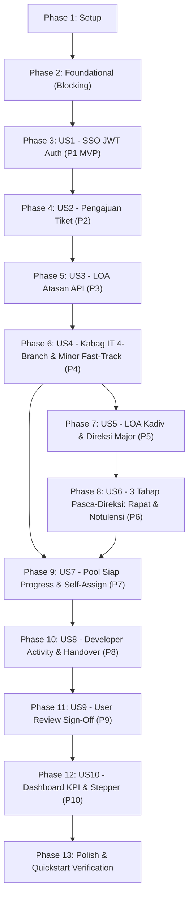

# Tasks: Master Sistem Aplikasi IT Helpdesk Enterprise (End-to-End)

**Input**: Design documents from `specs/004-sso-loa-integration/` ([spec.md](./spec.md), [plan.md](./plan.md), [data-model.md](./data-model.md), [contracts/](./contracts/), [research.md](./research.md), [quickstart.md](./quickstart.md)) aligned with [Constitution v3.1.0](../../.specify/memory/constitution.md).

**Prerequisites**: [plan.md](./plan.md) (required), [spec.md](./spec.md) (required), [data-model.md](./data-model.md), [contracts/](./contracts/)

**Tests**: Test tasks are included per story to enforce Test-Driven Verification (Constitution Principle VII) and validate the 10 User Stories independently.

**Organization**: Tasks are grouped by user story (US1 to US10) to enable independent implementation, testing, and MVP delivery.

## Format: `[ID] [P?] [Story] Description with exact file path`

- **[P]**: Can run in parallel (different files, no dependencies on incomplete tasks)
- **[Story]**: Which user story this task belongs to (e.g., [US1], [US2], [US3]... [US10])
- File paths are exact and point to the Laravel project structure per [plan.md](./plan.md)

---

## Phase 1: Setup (Shared Infrastructure)

**Purpose**: Project initialization, environment configuration, and private disk storage setup

- [X] T001 Configure environment configuration variables and service credentials template for SSO JWT and LOA API in `.env.example`
- [X] T002 [P] Configure private file storage disk in `config/filesystems.php` for attachments (`storage/app/private/attachments`) and meeting minutes (`storage/app/private/meeting_minutes`) with private access controls
- [X] T003 [P] Configure API route group, exception handling, and rate limiting in `bootstrap/app.php` and `routes/api.php`

---

## Phase 2: Foundational (Blocking Prerequisites)

**Purpose**: Core database migrations, Eloquent entities, audit service, and state machine that MUST be complete before ANY user story can be implemented

**⚠️ CRITICAL**: No user story implementation can begin until this phase is complete.

- [X] T004 Update database migration for `users` table in `database/migrations/0001_01_01_000000_create_users_table.php` (constraints: `sso_id` VARCHAR(191) Nullable Unique Indexed, `name` VARCHAR(255) Not Null, `email` VARCHAR(255) Unique Indexed, `password` VARCHAR(255) Nullable, `role` VARCHAR(50) Not Null Indexed: `requester`, `supervisor`, `it_head`, `kadiv_it`, `direksi`, `it_developer`, `admin`, `department` VARCHAR(100) Nullable, `supervisor_id` BIGINT UNSIGNED Nullable FK -> users.id, `sso_metadata` JSON Nullable)
- [X] T005 [P] Update database migration for `tickets` table in `database/migrations/2026_10_28_000002_create_tickets_table.php` (constraints: `ticket_number` VARCHAR(50) Unique Indexed format `TICK-YYYYMMDD-XXXX`, `user_id` BIGINT UNSIGNED FK -> users.id, `supervisor_id` BIGINT UNSIGNED Nullable FK -> users.id, `assigned_to` BIGINT UNSIGNED Nullable FK -> users.id, `title` VARCHAR(255) Not Null, `description` TEXT Not Null, `category` VARCHAR(50) Not Null: `hardware`, `software`, `network`, `access`, `classification` VARCHAR(20) Nullable: `minor`, `major`, `status` VARCHAR(50) Not Null Indexed, timestamps: `approved_by_supervisor_at`, `approved_by_it_head_at`, `approved_by_kadiv_at`, `approved_by_direksi_at`, `meeting_scheduled_at`, `minutes_submitted_at`, `minutes_approved_at`, `work_started_at`, `work_completed_at`, `closed_at`)
- [X] T006 [P] Create database migration for `external_loa_transactions` table in `database/migrations/2026_10_28_000003_create_external_loa_transactions_table.php` (constraints: `ticket_id` BIGINT UNSIGNED FK -> tickets.id Indexed, `approval_level` ENUM('supervisor', 'kadiv_it_ops', 'direksi') Not Null, `external_reference_id` VARCHAR(100) Nullable Indexed, `idempotency_key` VARCHAR(64) Unique Indexed, `sync_status` ENUM('pending', 'synced', 'sync_failed') Not Null Default 'pending', `decision` ENUM('waiting', 'approved', 'rejected', 'revision') Not Null Default 'waiting', `dispatched_at` TIMESTAMP Nullable, `decided_at` TIMESTAMP Nullable, `dispatch_payload_hash` VARCHAR(64) Nullable, `response_payload` JSON Nullable, `last_error_message` TEXT Nullable, `retry_count` INT UNSIGNED Default 0)
- [X] T007 [P] Update database migration for `meeting_minutes` table in `database/migrations/2026_10_28_000004_create_meeting_minutes_table.php` (constraints: `ticket_id` BIGINT UNSIGNED FK -> tickets.id Indexed, `submitted_by_user_id` BIGINT UNSIGNED FK -> users.id, `meeting_date` DATETIME Not Null, `attendees_summary` TEXT Not Null, `notes` LONGTEXT Not Null, `attachment_path` VARCHAR(255) Nullable, `is_approved_by_it_head` BOOLEAN Default FALSE, `approved_by_it_head_id` BIGINT UNSIGNED Nullable FK -> users.id, `approved_at` TIMESTAMP Nullable, `revision_comments` TEXT Nullable)
- [X] T008 [P] Update database migration for `ticket_audit_logs` table in `database/migrations/2026_10_28_000007_create_ticket_audit_logs_table.php` (constraints: `ticket_id` BIGINT UNSIGNED FK -> tickets.id Indexed, `actor_id` BIGINT UNSIGNED Nullable FK -> users.id, `action` VARCHAR(100) Not Null Indexed, `from_status` VARCHAR(50) Nullable, `to_status` VARCHAR(50) Not Null, `comments_or_reason` TEXT Nullable, `external_transaction_id` BIGINT UNSIGNED Nullable FK -> external_loa_transactions.id, `ip_address` VARCHAR(45) Nullable, `user_agent` TEXT Nullable, `payload_diff` JSON Nullable, `created_at` TIMESTAMP Not Null)
- [X] T009 [P] Update Eloquent Models (`User.php`, `Ticket.php`, `ExternalLoaTransaction.php`, `MeetingMinutes.php`, `TicketActivityLog.php`, `TicketReview.php`, `TicketAuditLog.php`) in `app/Models/` with relationship methods, attribute casts, and complete status constants
- [X] T010 Implement `AuditTrailService` in `app/Services/AuditTrailService.php` to write immutable append-only audit records with automated credential sanitization (zero tokens or secrets logged)
- [X] T011 Define `TicketStateMachine` in `app/Services/TicketStateMachine.php` enforcing valid transitions, Minor fast-track directly to Pool Siap Progress, Major post-Direksi sequence, and rejection terminal states

**Checkpoint**: Foundation ready — database migrations, models, state machine, and audit trail services are fully functional.

---

## Phase 3: User Story 1 - Autentikasi Pengguna Menggunakan SSO JWT Perusahaan (Priority: P1) 🎯 MVP

**Goal**: Authenticate all company users via corporate SSO JWT API server-side, validate token claims, establish secure HttpOnly session, and ensure zero token storage in browser localStorage or application logs.

**Independent Test**: Pengguna mengakses login, menginput kredensial SSO, backend memanggil SSO API, memverifikasi klaim token JWT, membuat sesi terotentikasi HttpOnly, dan mencegah penyimpanan JWT di localStorage maupun log.

### Tests for User Story 1
- [X] T012 [P] [US1] Create automated feature tests for SSO login, valid/invalid JWT validation, secure HttpOnly session, and token log sanitization in `tests/Feature/SsoAuthenticationTest.php`

### Implementation for User Story 1
- [X] T013 [P] [US1] Define `SsoServiceInterface` in `app/Services/Contracts/SsoServiceInterface.php` with `authenticate(string $username, string $password): array` and `validateToken(string $jwtToken): ?array`
- [X] T014 [P] [US1] Implement `EnterpriseSsoService` in `app/Services/EnterpriseSsoService.php` using Laravel Http client to communicate with corporate SSO endpoint and validate JWT signature, issuer, and expiration server-side
- [X] T015 [P] [US1] Implement `MockSsoService` in `app/Services/MockSsoService.php` to provide deterministic authentication responses for automated testing and local development
- [X] T016 [US1] Implement `LoginRequest` in `app/Http/Requests/LoginRequest.php` validating username and password with rate limiting
- [X] T017 [US1] Implement `AuthController` in `app/Http/Controllers/AuthController.php` coordinating SSO authentication, user profile mapping, HttpOnly session regeneration, and secure logout
- [X] T018 [US1] Update login view in `resources/views/auth/login.blade.php` adhering to Clean Minimalist Enterprise Light Mode styling without local credential creation options

**Checkpoint**: At this point, User Story 1 is fully functional and delivers the core authentication MVP.

---

## Phase 4: User Story 2 - Pengajuan Permohonan Bantuan IT oleh Karyawan (Priority: P2)

**Goal**: Requester submits a structured IT helpdesk ticket with category and attachment, generating collision-safe ticket number `TICK-YYYYMMDD-XXXX` and initial status `menunggu_approval_atasan`.

**Independent Test**: Karyawan mengisi form permohonan dengan lampiran valid, sistem membangkitkan nomor unik, mengaitkan atasan langsung, menyimpan berkas di storage privat, dan menetapkan status awal `menunggu_approval_atasan`.

### Tests for User Story 2
- [X] T019 [P] [US2] Create automated feature tests for ticket submission, file MIME validation, unique ticket number generation, and private attachment storage in `tests/Feature/TicketSubmissionTest.php`

### Implementation for User Story 2
- [X] T020 [P] [US2] Implement `StoreTicketRequest` in `app/Http/Requests/StoreTicketRequest.php` validating title (max:255), description, category (`hardware`, `software`, `network`, `access`), and attachments (MIME sanitization, max:10240 KB)
- [X] T021 [US2] Implement ticket creation action `store` in `app/Http/Controllers/TicketController.php` generating collision-safe ticket numbers, linking requester's supervisor, setting status `menunggu_approval_atasan`, and recording audit logs
- [X] T022 [US2] Implement ticket creation view in `resources/views/tickets/create.blade.php` with category selector, rich description, and secure drag-and-drop file upload

**Checkpoint**: User Stories 1 and 2 work seamlessly together for user intake.

---

## Phase 5: User Story 3 - Integrasi Delegasi Persetujuan LOA Atasan Langsung via API Eksternal & Penanganan Kegagalan (Priority: P3)

**Goal**: Orchestrate first-line supervisor approval delegation via external LOA API with idempotency keys, timeout/failure resilience, and inbound webhook/polling synchronization.

**Independent Test**: Tiket diajukan -> sistem memanggil API LOA eksternal berbekal `Idempotency-Key` -> menguji keputusan Setuju (lanjut ke Kabag IT), Tolak (ke `ditolak_atasan`), Revisi (ke `revisi_requester`), dan penanganan timeout HTTP tanpa perubahan prematur status lokal.

### Tests for User Story 3
- [X] T023 [P] [US3] Create automated feature tests for Supervisor LOA API dispatch, webhook callbacks, idempotency, and timeout/error handling in `tests/Feature/ExternalLoaIntegrationTest.php`
- [X] T024 [P] [US3] Create unit tests for determinism and collision safety of `idempotency_key` generation in `tests/Unit/LoaIdempotencyTest.php`

### Implementation for User Story 3
- [X] T025 [P] [US3] Define `LoaServiceInterface` in `app/Services/Contracts/LoaServiceInterface.php` specifying dispatch, status polling, and webhook processing contracts
- [X] T026 [P] [US3] Implement `EnterpriseLoaService` in `app/Services/EnterpriseLoaService.php` using Laravel Http client with timeout resilience, `Idempotency-Key` headers, `sync_failed` status recording, and retry logic
- [X] T027 [P] [US3] Implement `MockLoaService` in `app/Services/MockLoaService.php` providing controllable LOA responses (approved, rejected, revision, timeout, 500 error) for testing
- [X] T028 [P] [US3] Implement `VerifyLoaWebhookSignature` middleware in `app/Http/Middleware/VerifyLoaWebhookSignature.php` verifying HMAC SHA256 signatures on inbound webhooks
- [X] T029 [US3] Implement `LoaWebhookController` in `app/Http/Controllers/Api/LoaWebhookController.php` handling inbound supervisor approval decisions and recording audit logs
- [X] T030 [US3] Implement manual sync action `syncLoaStatus` in `app/Http/Controllers/TicketController.php` allowing authorized users to poll external LOA status after connection recovery

**Checkpoint**: First-line approval delegation via external LOA API is resilient and operational.

---

## Phase 6: User Story 4 - Peninjauan, Klasifikasi Minor/Major & 4 Cabang Keputusan oleh Kepala Bagian IT (Priority: P4)

**Goal**: Kepala Bagian IT reviews supervisor-approved tickets, sets classification (Minor vs. Major), and executes one of 4 explicit branches: Setuju Minor -> Pool Siap Progress, Setuju Major -> LOA Kadiv IT, Revisi -> Revisi Requester (re-verified by Supervisor), Tolak -> Pool Tiket Ditolak.

**Independent Test**: Kabag IT mengakses tiket berstatus `menunggu_approval_it_head`: menguji 4 cabang keputusan eksplisit dan memastikan tiket Minor langsung masuk ke `siap_dikerjakan` pada Pool Siap Progress.

### Tests for User Story 4
- [X] T031 [P] [US4] Create automated feature tests for Kabag IT 4 explicit decision branches, Minor fast-track bypass, and role policy authorization in `tests/Feature/MinorWorkflowTest.php`

### Implementation for User Story 4
- [X] T032 [P] [US4] Implement `ItHeadDecisionRequest` in `app/Http/Requests/ItHeadDecisionRequest.php` validating decision (`minor_approved`, `major_approved`, `revision`, `rejected`) and requiring mandatory reason/notes for rejection and revision
- [X] T033 [US4] Implement `itHeadDecision` action in `app/Http/Controllers/TicketController.php` processing the 4 branches, dispatching Minor tickets to `siap_dikerjakan` in Pool Siap Progress and Major tickets to `menunggu_loa_kadiv_it`
- [X] T034 [US4] Update `TicketPolicy` in `app/Policies/TicketPolicy.php` restricting `reviewItHead` strictly to users with role `it_head`

**Checkpoint**: Minor fast-track and Kabag IT 4-branch governance are fully operational.

---

## Phase 7: User Story 5 - Integrasi Persetujuan LOA Eksekutif Major via API Eksternal (Kadiv IT & Ops lalu Direksi) (Priority: P5)

**Goal**: Sequentially dispatch LOA for Major tickets to Kadiv IT & Operasional, then upon approval to Direksi via external LOA API; rejections terminate tickets to `Pool Tiket Ditolak`.

**Independent Test**: Tiket Major diproses: LOA Kadiv IT disetujui -> otomatis memicu LOA Direksi -> disetujui Direksi -> tiket beralih ke `menunggu_rapat_major` (DILARANG masuk ke Pool Siap Progress); penolakan pada tingkat manapun memindahkan tiket ke `Pool Tiket Ditolak`.

### Tests for User Story 5
- [X] T035 [P] [US5] Create automated feature tests for sequential executive LOA dispatch (Kadiv IT & Ops -> Direksi) and rejection handling in `tests/Feature/MajorWorkflowTest.php`

### Implementation for User Story 5
- [X] T036 [US5] Extend `EnterpriseLoaService` and `TicketStateMachine` in `app/Services/TicketStateMachine.php` to automate sequential dispatch from Kadiv IT & Ops to Direksi upon approval
- [X] T037 [US5] Update `LoaWebhookController` in `app/Http/Controllers/Api/LoaWebhookController.php` to handle executive decisions (`kadiv_it_ops`, `direksi`), transition approved tickets to `menunggu_rapat_major`, and transition rejected tickets to `ditolak_kadiv_it` or `ditolak_direksi`

**Checkpoint**: Major executive approval chain is enforced via external LOA API.

---

## Phase 8: User Story 6 - Tiga Tahapan Wajib Pasca-LOA Direksi: Rapat Kabag IT, Input Notulensi User, & Approval Notulensi Kabag IT (Priority: P6) 🎯 Governance Milestone

**Goal**: Complete the 3 mandatory post-Direksi stages for Major requests: (1) Rapat Koordinasi Kabag IT, (2) Input Notulensi by user pemohon, and (3) Approval Notulensi by Kabag IT with revision loop before entering Pool Siap Progress.

**Independent Test**: Major post-Direksi ticket: Kabag IT records meeting -> status becomes `menunggu_input_notulensi` -> user submits minutes -> status becomes `menunggu_approval_notulensi` -> Kabag IT approves -> ticket enters Pool Siap Progress; Kabag IT requests revision -> status becomes `revisi_notulensi_major` -> user resubmits -> Kabag IT approves.

### Tests for User Story 6
- [X] T038 [P] [US6] Create automated feature tests for post-Direksi meeting scheduling, user minutes submission, Kabag IT minutes approval, and revision loop in `tests/Feature/MajorPostDireksiMeetingTest.php`

### Implementation for User Story 6
- [X] T039 [P] [US6] Implement `ScheduleMeetingRequest` in `app/Http/Requests/ScheduleMeetingRequest.php` validating `meeting_date` (DATETIME Not Null) and `attendees_summary` (TEXT Not Null)
- [X] T040 [P] [US6] Implement `SubmitMeetingMinutesRequest` in `app/Http/Requests/SubmitMeetingMinutesRequest.php` validating `notes` (LONGTEXT Not Null) and optional attachment
- [X] T041 [P] [US6] Implement `MeetingMinutesPolicy` in `app/Policies/MeetingMinutesPolicy.php` enforcing user pemohon rights for minutes submission and Kabag IT rights for meeting scheduling and minutes approval/revision
- [X] T042 [US6] Implement `TicketMeetingController` in `app/Http/Controllers/TicketMeetingController.php` with `scheduleMeeting`, `submitMinutes`, `approveMinutes`, and `reviseMinutes` actions
- [X] T043 [US6] Create modal Blade views in `resources/views/tickets/partials/meeting_modal.blade.php` and `resources/views/tickets/partials/minutes_modal.blade.php` for meeting recording and minutes submission/revision

**Checkpoint**: The 3 mandatory post-Direksi governance stages for Major requests are strictly enforced with zero bypass risk.

---

## Phase 9: User Story 7 - Antrean Terbuka Pool Siap Progress & Proteksi Konkurensi Atomic Self-Assign (Priority: P7)

**Goal**: IT developer claims tickets from `Pool Siap Progress` using database pessimistic locking (`lockForUpdate`) guaranteeing zero race condition conflicts.

**Independent Test**: Dua developer mengklaim tiket yang sama secara simultan di detik yang sama; hanya satu developer yang berhasil mengklaim tiket, developer kedua menerima notifikasi penolakan ramah, dan tiket beralih ke `dalam_pengerjaan`.

### Tests for User Story 7
- [X] T044 [P] [US7] Create automated concurrency feature test in `tests/Feature/ConcurrencySelfAssignTest.php` asserting that concurrent claims on `siap_dikerjakan` tickets produce exactly 1 winner and 0 race condition conflicts

### Implementation for User Story 7
- [X] T045 [US7] Implement atomic `selfAssign` method in `app/Http/Controllers/TicketController.php` using `DB::transaction` with `lockForUpdate`, verifying status `siap_dikerjakan`, assigning developer, setting status `dalam_pengerjaan`, and logging audit trail
- [X] T046 [US7] Update `TicketPolicy` in `app/Policies/TicketPolicy.php` restricting self-assignment action `claim` strictly to users with role `it_developer` on tickets currently in `Pool Siap Progress`

**Checkpoint**: Concurrency-safe self-assignment is verified and operational.

---

## Phase 10: User Story 8 - Pelaporan Aktivitas Penanganan oleh Developer & Penyerahan Pekerjaan Selesai (Priority: P8)

**Goal**: Assigned developer records progress activity logs with optional attachments and submits completed work to transition ticket to `menunggu_review_user`.

**Independent Test**: Developer penanggung jawab membuka tiket `dalam_pengerjaan`, mencatat log progres berkala dengan lampiran, lalu menekan "Selesai Dikerjakan"; developer lain diblokir dengan HTTP 403; status tiket berpindah ke `menunggu_review_user`.

### Tests for User Story 8
- [X] T047 [P] [US8] Create automated feature tests for developer progress logging, attachment handling, and work completion in `tests/Feature/TicketExecutionTest.php`

### Implementation for User Story 8
- [X] T048 [P] [US8] Implement `TicketActivityRequest` in `app/Http/Requests/TicketActivityRequest.php` validating `activity_note` (TEXT Not Null) and optional attachment
- [X] T049 [US8] Implement `store` action in `app/Http/Controllers/TicketActivityController.php` for recording developer progress notes and private file storage
- [X] T050 [US8] Implement `completeWork` action in `app/Http/Controllers/TicketController.php` transitioning ticket status to `menunggu_review_user` with `work_completed_at` timestamp

**Checkpoint**: Developer progress tracking and work handover are fully operational.

---

## Phase 11: User Story 9 - Review Hasil Pekerjaan & Kedaulatan Persetujuan oleh Pemohon (Sign-Off) (Priority: P9)

**Goal**: Requester exclusively reviews completed work with 2 actions: Accept (permanently close ticket with 1-5 rating & feedback) or Revisi (return ticket to `revisi_pekerjaan` assigned to the same developer).

**Independent Test**: Pemohon membuka tiket `menunggu_review_user`: (1) Accept -> status `selesai` dengan rating dan ulasan; (2) Revisi -> status `revisi_pekerjaan`, penugasan developer tetap bertahan; pengguna non-pemohon diblokir dengan HTTP 403.

### Tests for User Story 9
- [X] T051 [P] [US9] Create automated feature tests for requester review sovereignty, rating validation (1-5), and work revision loop in `tests/Feature/UserReviewClosureTest.php`

### Implementation for User Story 9
- [X] T052 [P] [US9] Implement `TicketReviewRequest` in `app/Http/Requests/TicketReviewRequest.php` validating action (`accept` or `revision`), rating (required on accept, integer 1 to 5), and feedback/reason
- [X] T053 [US9] Implement review submission in `app/Http/Controllers/TicketReviewController.php` storing `TicketReview`, updating ticket status (`selesai` or `revisi_pekerjaan`), and recording audit logs
- [X] T054 [US9] Update `TicketPolicy` in `app/Policies/TicketPolicy.php` restricting `reviewWork` strictly to the original requester

**Checkpoint**: Requester sign-off sovereignty and satisfaction ratings are strictly enforced.

---

## Phase 12: User Story 10 - Dashboard KPI Berbasis Peran, Visual Stepper Dinamis & Audit Trail Abadi (Priority: P10)

**Goal**: Provide personalized role-based KPI dashboards (6 roles), dynamic Visual Stepper (distinct Minor vs. Major paths), and immutable audit trail viewer.

**Independent Test**: Login dengan 6 peran berbeda (Requester, Supervisor, Kabag IT, Kadiv IT, Direksi, IT Developer), memverifikasi kartu metrik KPI dan antrean kerja, memeriksa Visual Stepper dinamis pada detail tiket, dan memverifikasi tab jejak audit.

### Tests for User Story 10
- [X] T055 [P] [US10] Create automated feature tests for role-based dashboards, visual stepper rendering (Minor vs Major), and audit trail immutability in `tests/Feature/DashboardAndAuditTest.php`

### Implementation for User Story 10
- [X] T056 [US10] Implement `DashboardController` in `app/Http/Controllers/DashboardController.php` querying role-specific KPI metrics and ticket queues (including `Pool Siap Progress` and `Pool Tiket Ditolak`)
- [X] T057 [P] [US10] Create role dashboard views in `resources/views/dashboard/` (`requester.blade.php`, `supervisor.blade.php`, `it_head.blade.php`, `it_developer.blade.php`, `kadiv_it.blade.php`, `direksi.blade.php`)
- [X] T058 [P] [US10] Implement dynamic Visual Stepper component in `resources/views/tickets/partials/visual_stepper.blade.php` dynamically displaying the 7-step Minor journey or the 11-step Major journey
- [X] T059 [US10] Update ticket detail view in `resources/views/tickets/show.blade.php` integrating the visual stepper, role action cards, meeting/minutes modals, and immutable audit trail tab

**Checkpoint**: Full enterprise UI, role-based dashboards, and audit transparency are delivered.

---

## Phase 13: Polish & Cross-Cutting Concerns

**Purpose**: End-to-end integration verification, cleanup, and security hardening

- [X] T060 [P] Update Quickstart end-to-end integration tests in `tests/Feature/QuickstartEndToEndTest.php` validating all 5 quickstart scenarios from `specs/004-sso-loa-integration/quickstart.md`
- [X] T061 Synchronize and sanitize all web and API routes in `routes/web.php` and `routes/api.php` strictly matching contracts in `contracts/web-and-webhook-routes.md`
- [X] T062 Execute full automated test suite via `php artisan test` and verify 100% test pass rate with zero regressions

---

## Dependencies & Execution Order

### Phase Dependencies

### Within Each User Story
1. Automated tests written and verified failing (if testing new endpoints)
2. Models / Migrations / Services implemented
3. Form Requests / Policies implemented
4. Controller actions and views implemented
5. Story verified independently before advancing

---

## Parallel Opportunities

- **Setup & Foundational**:
  - `T002`, `T003` can run in parallel with `T001`
  - Migrations `T005`, `T006`, `T007`, `T008` can run in parallel with `T004`
- **User Story 1**:
  - Tests `T012`, Interfaces `T013`, Services `T014`, `T015` can be developed in parallel
- **User Story 3**:
  - Tests `T023`, `T024`, Interface `T025`, Services `T026`, `T027`, Middleware `T028` can be developed in parallel
- **User Story 6**:
  - Tests `T038`, Requests `T039`, `T040`, Policy `T041` can be developed in parallel
- **User Story 10**:
  - Views `T057`, `T058` can be developed in parallel with Controller `T056`

---

## Implementation Strategy

### MVP First (User Story 1 & 2 Intake)
1. Complete Phase 1: Setup (`T001` - `T003`)
2. Complete Phase 2: Foundational (`T004` - `T011`)
3. Complete Phase 3: User Story 1 (SSO Authentication MVP)
4. Validate User Story 1 independently (`php artisan test --filter=SsoAuthenticationTest`)

### Incremental Feature Delivery
1. Add US2 (Ticket Submission) → Validate independently
2. Add US3 (LOA Atasan API) → Validate independently
3. Add US4 (Kabag IT Minor Fast-Track) → Validate independently (First end-to-end path for Minor tickets!)
4. Add US5 & US6 (Major Executive Chain & 3 Post-Direksi Stages) → Validate Major governance
5. Add US7, US8, US9 (Execution & Sign-Off) → Complete full lifecycle
6. Add US10 & Polish → Complete visual dashboards, steppers, and quickstart scenarios
